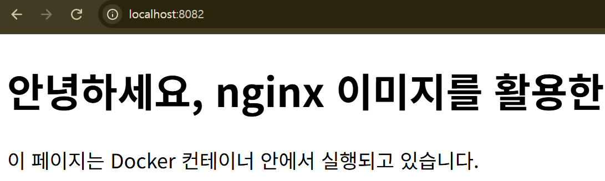
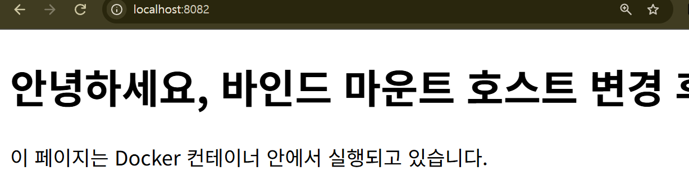

# Command Log

## 4. 터미널 조작

### 현재 위치 확인 (pwd)

```bash
root@cdcdc0e4bd3c:/# pwd
/
```

### 숨김 파일 포함 목록 확인 (ls -la)

```bash
root@cdcdc0e4bd3c:/# ls -la
total 60
drwxr-xr-x   1 root root 4096 Nov  3 12:19 .
drwxr-xr-x   1 root root 4096 Nov  3 12:19 ..
-rwxr-xr-x   1 root root    0 Nov  3 12:19 .dockerenv
drwxr-xr-x   2 root root 4096 Oct 25 10:26 .rock
lrwxrwxrwx   1 root root    7 Apr 20  2026 bin -> usr/bin
drwxr-xr-x   2 root root 4096 Apr 20  2026 boot
drwxr-xr-x   5 root root  360 Nov  3 12:19 dev
drwxr-xr-x   1 root root 4096 Nov  3 12:19 etc
drwxr-xr-x   3 root root 4096 Oct 25 10:26 home
lrwxrwxrwx   1 root root    7 Apr 20  2026 lib -> usr/lib
lrwxrwxrwx   1 root root    9 Apr 20  2026 lib64 -> usr/lib64
drwxr-xr-x   2 root root 4096 Oct 25 10:25 media
drwxr-xr-x   2 root root 4096 Oct 25 10:25 mnt
drwxr-xr-x   2 root root 4096 Oct 25 10:25 opt
dr-xr-xr-x 200 root root    0 Nov  3 12:19 proc
drwx------   2 root root 4096 Oct 25 10:26 root
drwxr-xr-x   4 root root 4096 Oct 25 10:26 run
lrwxrwxrwx   1 root root    8 Apr 20  2026 sbin -> usr/sbin
drwxr-xr-x   2 root root 4096 Oct 25 10:25 srv
dr-xr-xr-x  12 root root    0 Nov  3 12:19 sys
drwxrwxrwt   2 root root 4096 Oct 25 10:25 tmp
drwxr-xr-x  12 root root 4096 Oct 25 10:24 usr
drwxr-xr-x  11 root root 4096 Oct 25 10:26 var
```

### 절대 경로 이동, 상대 경로 이동 수행

```bash
root@cdcdc0e4bd3c:/# cd /ant/spider
root@cdcdc0e4bd3c:/ant/spider# cd ../../
root@cdcdc0e4bd3c:/#
```

### 디렉터리 생성 (mkdir -p)

```bash
root@cdcdc0e4bd3c:/# mkdir -p ant 
root@cdcdc0e4bd3c:/# ls
ant  bin  boot  dev  etc  home  lib  lib64  media  mnt  opt  proc  root  run  sbin  srv  sys  temp  tmp  usr  var
```

### 파일 복사 (cp), 파일 이동 또는 이름 변경 (mv)

```bash
# 파일 복사 (cp)
root@cdcdc0e4bd3c:/# cp -r /ant/spider /ant/dog
root@cdcdc0e4bd3c:/# cd /ant
root@cdcdc0e4bd3c:/ant# ls
dog  spider
# 파일 이동 (mv)
root@cdcdc0e4bd3c:/ant# ls
dog  spider
root@cdcdc0e4bd3c:/ant# mv ./spider ./dog/
root@cdcdc0e4bd3c:/ant# ls
dog
root@cdcdc0e4bd3c:/ant# ls ./dog
spider
# 이름 변경 (mv)
root@cdcdc0e4bd3c:/ant# ls ./dog
spider
root@cdcdc0e4bd3c:/ant# mv ./dog/spider ./ladybug
root@cdcdc0e4bd3c:/ant# ls
dog  ladybug
```

### 파일 삭제 (rm)(삭제 전후 목록 기록)

```bash
# 삭제 전
root@cdcdc0e4bd3c:/ant# ls /ant /ant/dog
/ant:
dog  ladybug

/ant/dog:
cat
# 삭제 후
root@cdcdc0e4bd3c:/ant# rm ./dog
rm: cannot remove './dog': Is a directory
root@cdcdc0e4bd3c:/ant# rm -r ./dog
root@cdcdc0e4bd3c:/ant# ls
ladybug
```

### 파일 내용 확인 (cat 또는 less)

```bash
root@cdcdc0e4bd3c:/# cat /etc/os-release 
PRETTY_NAME="Ubuntu 26.04.1 LTS"
NAME="Ubuntu"
VERSION_ID="26.04"
VERSION="26.04.1 LTS (Resolute Raccoon)"
VERSION_CODENAME=resolute
ID=ubuntu
ID_LIKE=debian
HOME_URL="https://www.ubuntu.com/"
SUPPORT_URL="https://help.ubuntu.com/"
BUG_REPORT_URL="https://bugs.launchpad.net/ubuntu/"
PRIVACY_POLICY_URL="https://www.ubuntu.com/legal/terms-and-policies/privacy-policy"
UBUNTU_CODENAME=resolute
LOGO=ubuntu-logo
```

### 빈 파일 생성 (touch)

```bash
root@cdcdc0e4bd3c:/ant# touch file.txt
root@cdcdc0e4bd3c:/ant# ls
file.txt  ladybug
root@cdcdc0e4bd3c:/ant# cat ./file.txt
root@cdcdc0e4bd3c:/ant#
```


## 5. 권한 실습

### 파일 1개 권한 확인 (ls -l), 변경 (chmod), 변경 전후 비교
```bash
root@cdcdc0e4bd3c:/ant# ls -l file.txt
-rw-r--r-- 1 root root 0 Nov  3 12:40 file.txt
root@cdcdc0e4bd3c:/ant# chmod 600 ./file.txt
root@cdcdc0e4bd3c:/ant# ls -l file.txt
-rw------- 1 root root 0 Nov  3 12:40 file.txt
```
### 디렉터리 1개 권한 확인 (ls -ld), 변경 (chmod), 변경 전후 비교
```bash
root@cdcdc0e4bd3c:/ant# ls -ld ladybug
drwxr-xr-x 2 root root 4096 Nov  3 12:26 ladybug
root@cdcdc0e4bd3c:/ant# chmod 700 ./ladybug
root@cdcdc0e4bd3c:/ant# ls -ld ladybug
drwx------ 2 root root 4096 Nov  3 12:26 ladybug
```
## 6. Docker

### 6-1. 설치 및 점검

#### docker --version 출력 기록
```powershell
PS C:\Users\<USER>\<FOLDER>\<PROJECT>\E1_1> docker --version
Docker version 29.9.2, build a82e528
```
#### docker info 출력 기록 (데몬 동작 확인)
```powershell
PS C:\Users\<USER>\<FOLDER>\<PROJECT>\E1_1> docker info
Client:
 Version:    29.9.2
 Context:    desktop-linux
 Debug Mode: false
 Plugins:
  agent: Docker AI Agent Runner (Docker Inc.)
    Version:  v1.152.0
    Path:     C:\Program Files\Docker\cli-plugins\docker-agent.exe
  ai: Docker AI Agent - Ask Gordon (Docker Inc.)
    Version:  v1.33.0
    Path:     C:\Program Files\Docker\cli-plugins\docker-ai.exe
  buildx: Docker Buildx (Docker Inc.)
    Version:  v0.38.1
    Path:     C:\Program Files\Docker\cli-plugins\docker-buildx.exe
  compose: Docker Compose (Docker Inc.)
    Version:  v5.6.1
    Path:     C:\Program Files\Docker\cli-plugins\docker-compose.exe
  debug: Get a shell into any image or container (Docker Inc.)
    Version:  0.49.0
    Path:     C:\Program Files\Docker\cli-plugins\docker-debug.exe
  desktop: Docker Desktop commands (Docker Inc.)
    Version:  4.97.0
    Path:     C:\Program Files\Docker\cli-plugins\docker-desktop.exe
  dhi: CLI for managing Docker Hardened Images (Docker Inc.)
    Version:  v0.0.9
    Path:     C:\Program Files\Docker\cli-plugins\docker-dhi.exe
  extension: Manages Docker extensions (Docker Inc.)
    Version:  v0.2.32
    Path:     C:\Program Files\Docker\cli-plugins\docker-extension.exe
  init: Creates Docker-related starter files for your project (Docker Inc.)
    Version:  v1.4.1
    Path:     C:\Program Files\Docker\cli-plugins\docker-init.exe
  mcp: Docker MCP Plugin (Docker Inc.)
    Version:  v0.44.2
    Path:     C:\Program Files\Docker\cli-plugins\docker-mcp.exe
  model: Docker Model Runner (Docker Inc.)
    Version:  v1.2.9
    Path:     C:\Program Files\Docker\cli-plugins\docker-model.exe
  offload: Docker Offload (Docker Inc.)
    Version:  v0.7.21
    Path:     C:\Program Files\Docker\cli-plugins\docker-offload.exe
  pass: Docker Pass Secrets Manager Plugin (beta) (Docker Inc.)
    Version:  v0.3.2
    Path:     C:\Program Files\Docker\cli-plugins\docker-pass.exe
  sandbox: "docker sandbox" is deprecated, use Docker Sandboxes instead (Docker Inc.)
    Version:  v0.13.0
    Path:     C:\Program Files\Docker\cli-plugins\docker-sandbox.exe
  scout: Docker Scout (Docker Inc.)
    Version:  v1.27.0
    Path:     C:\Program Files\Docker\cli-plugins\docker-scout.exe

Server:
 Containers: 0
  Running: 0
  Paused: 0
  Stopped: 0
 Images: 3
 Server Version: 29.9.2
 Storage Driver: overlayfs
  driver-type: io.containerd.snapshotter.v1
 Logging Driver: local
 Cgroup Driver: cgroupfs
 Cgroup Version: 2
 Plugins:
  Volume: local
  Network: bridge host ipvlan macvlan null overlay
  Log: awslogs fluentd gcplogs gelf journald json-file local splunk syslog
 CDI spec directories:
  /etc/cdi
  /var/run/cdi
 Discovered Devices:
  cdi: docker.com/gpu=webgpu
 Swarm: inactive
 Runtimes: nvidia runc io.containerd.runc.v2
 Default Runtime: runc
 Init Binary: docker-init
 containerd version: b7a25261e029d68978bbf290df0a62fc819b3c51
 runc version: v1.5.2-0-g29dd3dc2
 init version: de40ad0
 Security Options:
  seccomp
   Profile: builtin
  cgroupns
 Kernel Version: 6.18.54.1-microsoft-standard-WSL2
 Operating System: Docker Desktop
 OSType: linux
 Architecture: x86_64
 CPUs: 12
 Total Memory: 6.448GiB
 Name: docker-desktop
 ID: 550b5363-70ee-480b-86fe-9b010fd83450
 Docker Root Dir: /var/lib/docker
 Debug Mode: false
 HTTP Proxy: http.docker.internal:3128
 HTTPS Proxy: http.docker.internal:3128
 No Proxy: hubproxy.docker.internal
 Labels:
  com.docker.desktop.address=npipe://\\.\pipe\docker_cli
 Experimental: false
 Insecure Registries:
  hubproxy.docker.internal:5555
  127.0.0.0/8
  ::1/128
 Live Restore Enabled: false
 Firewall Backend: iptables
```
### 6-2. Docker 기본 운영 명령

#### 이미지: 다운로드/목록 확인(예: docker images)

```powershell
PS C:\Users\<USER>\<FOLDER>\<PROJECT>\E1_1> docker images
                                                                                                     i Info →   U  In Use
IMAGE                ID             DISK USAGE   CONTENT SIZE   EXTRA
hello-world:latest   c567b231f656       25.9kB         9.49kB    U   
my-web:latest        de28cc6696af        241MB         63.9MB        
ubuntu:latest        6a06111c3b0a        163MB         45.9MB    U 
```

#### 컨테이너: 실행/중지/목록 확인(예: docker ps, docker ps -a)

```powershell
#docker ps 기본 : 실행 중인 docker 컨테이너 목록 조회
PS C:\Users\<USER>\<FOLDER>\<PROJECT>\E1_1> docker ps  
CONTAINER ID   IMAGE     COMMAND       CREATED          STATUS         PORTS     NAMES
cdcdc0e4bd3c   ubuntu    "/bin/bash"   51 minutes ago   Up 2 minutes             mybox
#docker ps -a : 모든 docker 컨테이너 목록 조회 (all)
PS C:\Users\<USER>\<FOLDER>\<PROJECT>\E1_1> docker ps -a
CONTAINER ID   IMAGE         COMMAND       CREATED             STATUS                         PORTS     NAMES
ecfae3219076   ubuntu        "/bin/bash"   4 minutes ago       Exited (137) 2 minutes ago               yourbox
034b2e6b02d0   hello-world   "/hello"      5 minutes ago       Exited (0) 5 minutes ago                 keen_perlman
cdcdc0e4bd3c   ubuntu        "/bin/bash"   51 minutes ago      Up 2 minutes                             mybox
e0d56166363f   hello-world   "/hello"      About an hour ago   Exited (0) About an hour ago             elated_shockley
#docker ps -l : 가장 마지막으로 생성된 컨테이너 목록 조회 (latest) - 실행상태 무관
PS C:\Users\<USER>\<FOLDER>\<PROJECT>\E1_1> docker ps -l
CONTAINER ID   IMAGE     COMMAND       CREATED         STATUS                       PORTS     NAMES
ecfae3219076   ubuntu    "/bin/bash"   4 minutes ago   Exited (137) 2 minutes ago             yourbox
```

#### 운영: 로그 확인(예: docker logs), 리소스 확인(예: docker stats)

```powershell
# 로그 확인 (docker logs)
PS C:\Users\<USER>\<FOLDER>\<PROJECT>\E1_1> docker logs elated_shockley

Hello from Docker!
This message shows that your installation appears to be working correctly.

To generate this message, Docker took the following steps:
 1. The Docker client contacted the Docker daemon.
 2. The Docker daemon pulled the "hello-world" image from the Docker Hub.
    (amd64)
 3. The Docker daemon created a new container from that image which runs the
    executable that produces the output you are currently reading.
 4. The Docker daemon streamed that output to the Docker client, which sent it
    to your terminal.

To try something more ambitious, you can run an Ubuntu container with:
 $ docker run -it ubuntu bash

Share images, automate workflows, and more with a free Docker ID:
 https://hub.docker.com/

For more examples and ideas, visit:
 https://docs.docker.com/get-started/

# 리소스 확인 (docker stats)
PS C:\Users\<USER>\<FOLDER>\<PROJECT>\E1_1> docker stats mybox
CONTAINER ID   NAME      CPU %     MEM USAGE / LIMIT   MEM %     NET I/O   BLOCK I/O   PIDS
cdcdc0e4bd3c   mybox     0.00%     0B / 0B             0.00%     0B / 0B   0B / 0B     0
```

#### 컨테이너 실행, 중지, 재시작, 삭제 각 단계의 상태 변화 기록

```powershell
PS C:\Users\<USER>\<FOLDER>\<PROJECT>\E1_1> docker ps -a
CONTAINER ID   IMAGE     COMMAND       CREATED          STATUS                       PORTS     NAMES
cdcdc0e4bd3c   ubuntu    "/bin/bash"   53 minutes ago   Exited (137) 3 seconds ago             mybox
# 컨테이너 실행
PS C:\Users\<USER>\<FOLDER>\<PROJECT>\E1_1> docker start mybox
mybox
PS C:\Users\<USER>\<FOLDER>\<PROJECT>\E1_1> docker ps -a      
CONTAINER ID   IMAGE     COMMAND       CREATED          STATUS         PORTS     NAMES
cdcdc0e4bd3c   ubuntu    "/bin/bash"   54 minutes ago   Up 3 seconds             mybox
# 컨테이너 중지
PS C:\Users\<USER>\<FOLDER>\<PROJECT>\E1_1> docker stop mybox
mybox
PS C:\Users\<USER>\<FOLDER>\<PROJECT>\E1_1> docker ps -a     
CONTAINER ID   IMAGE     COMMAND       CREATED          STATUS                       PORTS     NAMES
cdcdc0e4bd3c   ubuntu    "/bin/bash"   54 minutes ago   Exited (137) 4 seconds ago             mybox
# 컨테이너 재시작
PS C:\Users\<USER>\<FOLDER>\<PROJECT>\E1_1> docker start mybox
mybox
PS C:\Users\<USER>\<FOLDER>\<PROJECT>\E1_1> docker ps -a      
CONTAINER ID   IMAGE     COMMAND       CREATED          STATUS         PORTS     NAMES
cdcdc0e4bd3c   ubuntu    "/bin/bash"   54 minutes ago   Up 9 seconds             mybox
PS C:\Users\<USER>\<FOLDER>\<PROJECT>\E1_1> docker restart mybox
mybox
PS C:\Users\<USER>\<FOLDER>\<PROJECT>\E1_1> docker ps -a        
CONTAINER ID   IMAGE     COMMAND       CREATED          STATUS        PORTS     NAMES
cdcdc0e4bd3c   ubuntu    "/bin/bash"   54 minutes ago   Up 1 second             mybox
# 컨테이너 삭제
PS C:\Users\<USER>\<FOLDER>\<PROJECT>\E1_1> docker stop mybox
mybox
PS C:\Users\<USER>\<FOLDER>\<PROJECT>\E1_1> docker rm mybox
mybox
PS C:\Users\<USER>\<FOLDER>\<PROJECT>\E1_1> docker ps -a
CONTAINER ID   IMAGE     COMMAND   CREATED   STATUS    PORTS     NAMES
```


### 6-3. 컨테이너 실행 실습

#### hello-world 실행 성공 기록
```powershell
PS C:\Users\<USER>\<FOLDER>\<PROJECT>\E1_1> docker run hello-world

Hello from Docker!
This message shows that your installation appears to be working correctly.

To generate this message, Docker took the following steps:
 1. The Docker client contacted the Docker daemon.
 2. The Docker daemon pulled the "hello-world" image from the Docker Hub.
    (amd64)
 3. The Docker daemon created a new container from that image which runs the
    executable that produces the output you are currently reading.
 4. The Docker daemon streamed that output to the Docker client, which sent it
    to your terminal.

To try something more ambitious, you can run an Ubuntu container with:
 $ docker run -it ubuntu bash

Share images, automate workflows, and more with a free Docker ID:
 https://hub.docker.com/

For more examples and ideas, visit:
 https://docs.docker.com/get-started/
```
#### ubuntu 이미지 다운로드
```powershell
PS C:\Users\<USER>\<FOLDER>\<PROJECT>\E1_1> docker pull ubuntu
Using default tag: latest
latest: Pulling from library/ubuntu
f3f25b84a7d7: Pull complete 
edafa32f5d9e: Pull complete 
21594acc2d8b: Download complete 
Digest: sha256:6a06111c3b0a8600feadb270aec771dc239bf407b25625f93f44ab00e11f4d3c
Status: Downloaded newer image for ubuntu:latest
docker.io/library/ubuntu:latest
```
#### ubuntu 컨테이너 대화형 실행, 내부에서 ls와 echo 수행 결과 기록
```console
PS C:\Users\<USER>\<FOLDER>\<PROJECT>\E1_1> docker run -it --name mybox ubuntu
root@cdcdc0e4bd3c:/# ls
bin  boot  dev  etc  home  lib  lib64  media  mnt  opt  proc  root  run  sbin  srv  sys  tmp  usr  var
root@cdcdc0e4bd3c:/# echo $SHELL
/bin/bash
```
#### attach와 exec의 차이 정리
docker attach 컨테이너ID : 
컨테이너의 메인 프로세스에 표준 입출력을 연결함. exit 입력 시 메인 프로세스 즉 컨테이너가 종료됨
```console
PS C:\Users\<USER>\<FOLDER>\<PROJECT>\E1_1> docker start mybox
mybox
PS C:\Users\<USER>\<FOLDER>\<PROJECT>\E1_1> docker ps -a
CONTAINER ID   IMAGE     COMMAND       CREATED          STATUS         PORTS     NAMES
f51cf60939c8   ubuntu    "/bin/bash"   55 seconds ago   Up 4 seconds             mybox
PS C:\Users\<USER>\<FOLDER>\<PROJECT>\E1_1> docker attach mybox
root@f51cf60939c8:/# exit
exit
PS C:\Users\<USER>\<FOLDER>\<PROJECT>\E1_1> docker ps -a
CONTAINER ID   IMAGE     COMMAND       CREATED              STATUS                     PORTS     NAMES
f51cf60939c8   ubuntu    "/bin/bash"   About a minute ago   Exited (0) 4 seconds ago             mybox
```

docker exec 컨테이너ID 명령어: 
컨테이너에 메인 프로세스와 무관한 새 프로세스를 실행하여 명령어에 대한 출력값을 받고 프로세스를 종료함. -it(대화형) 옵션을 사용하여 bash등과 같은 대화형 쉘을 사용할 수 있음. 이 때 exit를 입력하면 쉘이 종료되고 메인 프로세스는 계속 실행이 유지됨.

```console
PS C:\Users\<USER>\<FOLDER>\<PROJECT>\E1_1> docker ps -a
CONTAINER ID   IMAGE     COMMAND       CREATED         STATUS         PORTS     NAMES
f51cf60939c8   ubuntu    "/bin/bash"   5 minutes ago   Up 4 minutes             mybox
PS C:\Users\<USER>\<FOLDER>\<PROJECT>\E1_1> docker exec mybox ls
bin
boot
dev
etc
home
lib
lib64
media
mnt
opt
proc
root
run
sbin
srv
sys
tmp
usr
var
PS C:\Users\<USER>\<FOLDER>\<PROJECT>\E1_1> docker ps -a
CONTAINER ID   IMAGE     COMMAND       CREATED         STATUS         PORTS     NAMES
f51cf60939c8   ubuntu    "/bin/bash"   6 minutes ago   Up 4 minutes

# docker exec -it 컨테이너ID 쉘 예시
PS C:\Users\<USER>\<FOLDER>\<PROJECT>\E1_1> docker ps -a
CONTAINER ID   IMAGE     COMMAND       CREATED         STATUS         PORTS     NAMES
f51cf60939c8   ubuntu    "/bin/bash"   9 minutes ago   Up 8 minutes             mybox
PS C:\Users\<USER>\<FOLDER>\<PROJECT>\E1_1> docker exec -it mybox bash
root@f51cf60939c8:/# ls
bin  boot  dev  etc  home  lib  lib64  media  mnt  opt  proc  root  run  sbin  srv  sys  tmp  usr  var
root@f51cf60939c8:/# exit
exit

What's next:
    Try Docker Debug for seamless, persistent debugging tools in any container or image → docker debug mybox
    Learn more at https://docs.docker.com/go/debug-cli/
PS C:\Users\<USER>\<FOLDER>\<PROJECT>\E1_1> docker ps -a
CONTAINER ID   IMAGE     COMMAND       CREATED          STATUS          PORTS     NAMES
f51cf60939c8   ubuntu    "/bin/bash"   15 minutes ago   Up 13 minutes
```

## 7. Dockerfile 기반 웹 서버 컨테이너

### docker build 실행 명령 및 결과 로그
빌드 및 확인

```powershell
PS C:\Users\<USER>\<FOLDER>\<PROJECT>\E1_1> docker build -t exam .
[+] Building 7.8s (7/7) FINISHED                                          docker:desktop-linux
 => [internal] load build definition from Dockerfile                                      0.0s
 => => transferring dockerfile: 223B                                                      0.0s
 => [internal] load metadata for docker.io/library/nginx:stable-alpine                    3.0s
 => [internal] load .dockerignore                                                         0.0s
 => => transferring context: 2B                                                           0.0s
 => [internal] load build context                                                         0.0s
 => => transferring context: 59B                                                          0.0s
 => [1/2] FROM docker.io/library/nginx:stable-alpine@sha256:0e52bd054126cdc040b1276c0af3  3.0s
 => => resolve docker.io/library/nginx:stable-alpine@sha256:0e52bd054126cdc040b1276c0af3  0.0s
 => => sha256:5b8cb54cfa408030aaa43d7bffa9141e0ae6f8a479df13c7aa152100 20.31MB / 20.31MB  2.1s
 => => sha256:bb658a2541968d2b90a8ee165ad08b7f71055c7f7832bdff98e2de2d8b 1.40kB / 1.40kB  0.5s
 => => sha256:81b64ae234ef95f3cfc19b7f6c45a511eccbefa6148889ee33ed43c6c3 1.21kB / 1.21kB  0.6s
 => => sha256:e125989d16f03d1e00b60afdd9abe46ed1437ed63b73926d036a5537f6be77 403B / 403B  0.7s
 => => sha256:885725a63a7cf1d4d5aac105944b35ece2b69a8c2cc6f7040f04727b7b8a63 964B / 964B  0.2s
 => => sha256:f19a2d3b695178ba0e57d473535f74f5d934f45e191de8334e730f83d2c627 627B / 627B  0.2s
 => => sha256:9f0afb44f10e826253b342c0265e188067c2f0a30c782a52e329928a76 1.88MB / 1.88MB  1.0s
 => => extracting sha256:9f0afb44f10e826253b342c0265e188067c2f0a30c782a52e329928a763adc6  0.2s
 => => extracting sha256:f19a2d3b695178ba0e57d473535f74f5d934f45e191de8334e730f83d2c6270  0.0s
 => => extracting sha256:885725a63a7cf1d4d5aac105944b35ece2b69a8c2cc6f7040f04727b7b8a63d  0.1s
 => => extracting sha256:e125989d16f03d1e00b60afdd9abe46ed1437ed63b73926d036a5537f6be770  0.0s
 => => extracting sha256:81b64ae234ef95f3cfc19b7f6c45a511eccbefa6148889ee33ed43c6c3f3993  0.0s
 => => extracting sha256:bb658a2541968d2b90a8ee165ad08b7f71055c7f7832bdff98e2de2d8b90cf1  0.0s
 => => extracting sha256:5b8cb54cfa408030aaa43d7bffa9141e0ae6f8a479df13c7aa152100cca358f  0.4s
 => [2/2] COPY src/index.html /usr/share/nginx/html/index.html                            0.2s
 => exporting to image                                                                    1.3s
 => => exporting layers                                                                   0.2s
 => => exporting manifest sha256:b213b9f8d2d446bb27b332c3e4861eb4da341d1d9a47f3118e06038  0.0s
 => => exporting config sha256:fb1ddaa55058bc1b22f6ae61114226f7fa77a1985d7faeaa2310c6dfa  0.0s
 => => exporting attestation manifest sha256:592e031c43577f67d5a4726911818810341c58b5517  0.0s
 => => exporting manifest list sha256:792e890320716d914ecc78a650a132aa4328defe969ee785f1  0.0s
 => => naming to docker.io/library/exam:latest                                            0.0s
 => => unpacking to docker.io/library/exam:latest

PS C:\Users\<USER>\<FOLDER>\<PROJECT>\E1_1> docker images
                                                                          i Info →   U  In Use
IMAGE                ID             DISK USAGE   CONTENT SIZE   EXTRA
exam:latest          792e89032071       92.7MB         26.1MB        
hello-world:latest   c567b231f656       25.9kB         9.49kB        
my-web:latest        de28cc6696af        241MB         63.9MB        
ubuntu:latest        6a06111c3b0a        163MB         45.9MB
```

실행 및 결과

```powershell
PS C:\Users\<USER>\<FOLDER>\<PROJECT>\E1_1> docker run -d -p 8080:80 --name exam1 exam
23d21ba10c8b57f64a62bf1a890330687cf47009b60b3a01130a1d973b007e29

PS C:\Users\<USER>\<FOLDER>\<PROJECT>\E1_1> docker ps -a
CONTAINER ID   IMAGE     COMMAND                   CREATED         STATUS                     PORTS                                     NAMES
23d21ba10c8b   exam      "/docker-entrypoint.…"   4 minutes ago   Up 4 minutes               0.0.0.0:8080->80/tcp, [::]:8080->80/tcp   exam1
f51cf60939c8   ubuntu    "/bin/bash"               20 hours ago    Exited (255) 2 hours ago                                         mybox
```

## 9. 바인드 마운트 반영 + 볼륨 영속성 증거

### 9-1. 바인드 마운트 반영

#### 호스트 디렉터리를 컨테이너에 연결하는 실행 명령 기록

```
PS C:\Users\<USER>\<FOLDER>\<PROJECT>\E1_1> docker run -d --name bind-mount-p 8082:80 --mount type=bind,source="C:\Users\<USER>\<FOLDER>\<PROJECT>\E1_1\src\index.html",target=/usr/share/nginx/html/index.html,readonly nginx
Unable to find image 'nginx:latest' locally
latest: Pulling from library/nginx
Digest: sha256:5ab5b0b01097420873a3f3330f44248e34a3c2a3e8d5ee30658aeae8cb7435da
Status: Downloaded newer image for nginx:latest
303efc9479f57785231cf6340644d9670df164de2b4614a841bf8849514bffe2
```

#### 호스트 파일 변경 전/후 내용 비교

호스트 파일 변경 전


호스트 파일 변경 후


### 9-2. Docker 볼륨 영속성 검증

#### 삭제 전 데이터 준비

##### 볼륨 생성/연결/검증 로그

```powershell
PS C:\Users\<USER>\<FOLDER>\<PROJECT>\E1_1> docker ps
CONTAINER ID   IMAGE     COMMAND   CREATED   STATUS    PORTS     NAMES
PS C:\Users\<USER>\<FOLDER>\<PROJECT>\E1_1> docker volume ls
DRIVER    VOLUME NAME
# 생성
PS C:\Users\<USER>\<FOLDER>\<PROJECT>\E1_1> docker volume create mydata 
mydata
# 연결
PS C:\Users\<USER>\<FOLDER>\<PROJECT>\E1_1> docker run -d --name test1 -v mydata:/data nginx 
1f1cf8ee9c066dff404401d0dc922af6bacaddbfeaf2ff8c685c495037893678
# 볼륨 내 데이터 생성
PS C:\Users\<USER>\<FOLDER>\<PROJECT>\E1_1> docker exec test1 sh -c "echo 영속성 테스트 > /data/test.txt"
```

##### 컨테이너 삭제 전 데이터 확인 기록 (데이터 값 또는 파일 내용 원문 포함)

```powershell
# 볼륨 내 데이터 확인
PS C:\Users\<USER>\<FOLDER>\<PROJECT>\E1_1> docker exec test1 cat /data/test.txt
영속성 테스트
```

#### 컨테이너 삭제 명령과 출력 기록

```powershell
PS C:\Users\<USER>\<FOLDER>\<PROJECT>\E1_1> docker rm -f test1
test1
```

#### 컨테이너 삭제 직후 볼륨 목록에 해당 볼륨이 남아 있는지 확인 기록

```powershell
PS C:\Users\<USER>\<FOLDER>\<PROJECT>\E1_1> docker volume ls
DRIVER    VOLUME NAME
local     mydata
```

#### 삭제한 컨테이너와 같은 볼륨을 연결한 새 컨테이너 실행

```powershell
PS C:\Users\<USER>\<FOLDER>\<PROJECT>\E1_1> docker run -d --name test2 -v mydata:/data nginx
93e96c8ba0dd0a2bd75726bbdf7a741924e3a5f3c57b31e16c3bf37154ab8bcf
```

#### 삭제 전/후 데이터 유지 검증

##### 새 컨테이너에서 삭제 전과 동일한 데이터 확인 기록 (삭제 전 기록과 대조)

```powershell
PS C:\Users\<USER>\<FOLDER>\<PROJECT>\E1_1> docker exec test2 cat /data/test.txt
영속성 테스트
```

##### 볼륨을 연결하지 않은 대조용 컨테이너에서 같은 경로를 확인하여 데이터가 없음을 기록

```powershell
PS C:\Users\<USER>\<FOLDER>\<PROJECT>\E1_1> docker run -d --name test3 nginx
b6051d28443c31acb02af77dc1909f28c6de46602d339f388c95349288a48893

PS C:\Users\<USER>\<FOLDER>\<PROJECT>\E1_1> docker exec test3 cat /data/test.txt
cat: /data/test.txt: No such file or directory
```

## 11. 보안 및 개인정보

- 이 문서, 로그, 스크린샷에는 토큰, 비밀번호, 개인키, 인증 코드, 개인 이메일 주소를 포함하지 않습니다.
- 마스킹 형식: (기록, 예: ****-****)
- 민감정보가 노출된 경우의 처리 내역: (기록, 없으면 "해당 없음")

### README.md, command-log.md, 캡처에서 토큰, 비밀번호, 개인키, 인증 코드, 개인 이메일 검색
### 발견된 항목 마스킹 또는 제거
### 노출된 적이 있다면 제거 및 재발급 내역을 15번 섹션에 기록

## 12. 트러블 슈팅

### 12-1. 문제1

#### 12-1-1. 문제 및 원인 가설

```powershell
# Docker 커스텀 이미지 빌드 시도
PS C:\Users\<USER>\<FOLDER>\<PROJECT>\E1_1\evidences> docker build -f ./Dockerfile -t exam .
[+] Building 2.8s (6/6) FINISHED                            docker:desktop-linux
 => [internal] load build definition from Dockerfile                        0.0s
 => => transferring dockerfile: 108B                                        0.0s
 => [internal] load metadata for docker.io/library/nginx:alpine             2.5s
 => [internal] load .dockerignore                                           0.1s
 => => transferring context: 2B                                             0.0s
 => [internal] load build context                                           0.1s
 => => transferring context: 2B                                             0.0s
 => [1/2] FROM docker.io/library/nginx:alpine@sha256:785835ea65db4bba6f021  0.1s
 => => resolve docker.io/library/nginx:alpine@sha256:785835ea65db4bba6f021  0.1s
 => ERROR [2/2] COPY src/index.html /usr/share/nginx/html/index.html        0.0s
------
 > [2/2] COPY src/index.html /usr/share/nginx/html/index.html:
------
Dockerfile:2
--------------------
   1 |     FROM nginx:alpine
   2 | >>> COPY src/index.html /usr/share/nginx/html/index.html
--------------------
# 실패 원인 : not found
ERROR: failed to build: failed to solve: failed to compute cache key: failed to calculate checksum of ref t8rlv3xuwy8z383fhde6y0ebk::hwpet34bujgaz43b9i89s8fdd: "/src/index.html": not found
```

#### 12-1-3. 확인

```powershell
PS C:\Users\<USER>\<FOLDER>\<PROJECT>\E1_1\evidences> ls


    디렉터리: C:\Users\<USER>\<FOLDER>\<PROJECT>\E1_1\evidenc
    es


Mode                 LastWriteTime         Length Name                          
----                 -------------         ------ ----                          
d-----      2026-11-03   오후 7:17                local-only                    
-a----      2026-11-04   오후 5:36          24409 command-log.md                
-a----      2026-11-04   오후 4:58             71 Dockerfile                    
-a----      2026-11-02   오후 8:53          72565 vscode-github-login.png       
-a----      2026-11-02   오후 8:59          74789 vscode-repo-linked.png        


PS C:\Users\<USER>\<FOLDER>\<PROJECT>\E1_1\evidences> ls ../


    디렉터리: C:\Users\<USER>\<FOLDER>\<PROJECT>\E1_1


Mode                 LastWriteTime         Length Name                          
----                 -------------         ------ ----                          
d-----      2026-11-04   오후 4:58                evidences                     
d-----      2026-11-02   오후 7:30                generated                     
d-----      2026-11-03   오후 1:48                guide                         
d-----      2026-11-04   오후 4:33                nginx                         
d-----      2026-11-04   오후 4:58                src                           
-a----      2026-11-04   오후 5:33          17568 README.md                     


PS C:\Users\<USER>\<FOLDER>\<PROJECT>\E1_1\evidences> ls ../src


    디렉터리: C:\Users\<USER>\<FOLDER>\<PROJECT>\E1_1\src


Mode                 LastWriteTime         Length Name                          
----                 -------------         ------ ----                          
-a----      2026-11-04   오후 4:24            302 index.html                    
```

#### 12-1-4. 해결

```powershell
PS C:\Users\<USER>\<FOLDER>\<PROJECT>\E1_1\evidences> docker build -f ./Dockerfile -t exam ../
[+] Building 2.7s (7/7) FINISHED                            docker:desktop-linux
 => [internal] load build definition from Dockerfile                        0.1s
 => => transferring dockerfile: 108B                                        0.0s
 => [internal] load metadata for docker.io/library/nginx:alpine             1.0s
 => [internal] load .dockerignore                                           0.1s
 => => transferring context: 2B                                             0.0s
 => [internal] load build context                                           0.1s
 => => transferring context: 372B                                           0.0s
 => [1/2] FROM docker.io/library/nginx:alpine@sha256:785835ea65db4bba6f021  0.1s
 => => resolve docker.io/library/nginx:alpine@sha256:785835ea65db4bba6f021  0.0s
 => CACHED [2/2] COPY src/index.html /usr/share/nginx/html/index.html       0.0s
 => exporting to image                                                      1.2s
 => => exporting layers                                                     0.0s
 => => exporting manifest sha256:ada5cdd415b90c8429adb206c8a9d346ea0317102  0.0s
 => => exporting config sha256:49f0f4dc0b23a7d586681464e795d180a3818b7b26d  0.0s
 => => exporting attestation manifest sha256:c503844f07c4599dfa1c2919982fb  0.0s
 => => exporting manifest list sha256:3c5a22df25011ba104ebd497fc7560753989  0.0s
 => => naming to docker.io/library/exam:latest                              0.0s
 => => unpacking to docker.io/library/exam:latest                           1.0s
PS C:\Users\<USER>\<FOLDER>\<PROJECT>\E1_1\evidences> docker images
                                                            i Info →   U  In Use
IMAGE                ID             DISK USAGE   CONTENT SIZE   EXTRA
exam:latest          3c5a22df2501       93.6MB         26.3MB        
hello-world:latest   c567b231f656       25.9kB         9.49kB        
my-web:latest        de28cc6696af        241MB         63.9MB        
ubuntu:latest        6a06111c3b0a        163MB         45.9MB    U   
```

### 12-2. 문제2

#### 12-2-3. 확인

```bash
$ git config user.name songdajeon
fatal: not in a git directory

$ pwd
/c/Users/<USER>
```

#### 12-2-4. 해결

```bash
$ cd ./<FOLDER>/<PROJECT>/E1_1

<USER>@<HOST> UCRT64 ~/<FOLDER>/<PROJECT>/E1_1 (main)
$ git config user.name songdajeon

$ git config user.email 215927699+InGentleWave@users.noreply.github.com

$ git config init.defaultBranch main

# 초반 글로벌 설정 후 원격 연결 이후, 로컬 설정 새로 한 후의 리스트
$ git config --list
diff.astextplain.textconv=astextplain
filter.lfs.clean=git-lfs clean -- %f
filter.lfs.smudge=git-lfs smudge -- %f
filter.lfs.process=git-lfs filter-process
filter.lfs.required=true
http.sslbackend=schannel
core.autocrlf=true
core.fscache=true
core.symlinks=false
pull.rebase=false
credential.helper=manager
credential.https://dev.azure.com.usehttppath=true
init.defaultbranch=master
user.name=songdajeon
user.email=215927699+InGentleWave@users.noreply.github.com
init.defaultbranch=main
core.repositoryformatversion=0
core.filemode=false
core.bare=false
core.logallrefupdates=true
core.symlinks=false
core.ignorecase=true
remote.origin.url=https://github.com/InGentleWave/Codyssey_E1_1_Dev_Set-up_practice.git
remote.origin.fetch=+refs/heads/*:refs/remotes/origin/*
branch.main.remote=origin
branch.main.merge=refs/heads/main
```

## 13. 보너스 과제 (선택)

### Docker Compose 기초

#### 단일 서비스용 docker-compose.yml을 작성
#### Compose 실행 결과를 단일 컨테이너 실행과 비교해 기록
#### 실행 설정을 파일로 문서화하는 이유 정리

### Docker Compose 멀티 컨테이너

#### 웹 서버와 보조 서비스 1개 이상을 함께 실행
#### 웹 컨테이너에서 서비스 이름으로 접속되는지 확인하고 출력 기록
#### 서비스 이름 기반 컨테이너 간 통신 정리

### Compose 운영 명령어 습득

#### up, down, ps, logs를 각각 실행하고 출력 기록
#### Compose 명령 형태(docker compose 또는 docker-compose)와 버전 확인 후 기록
#### ps, logs 중심의 상태 확인 루틴 정리

### 환경 변수 활용

#### 포트 또는 실행 모드를 환경 변수로 지정
#### 값을 바꿔 실행하고 변경 전후 동작 차이 기록
#### 코드와 설정 분리의 이점 정리

### GitHub SSH 키 설정

#### Windows에서 SSH 키를 생성하고 공개 키를 GitHub에 등록
#### 원격 주소를 SSH로 바꾸고 푸시 성공 결과 기록
#### HTTPS와 SSH 키 인증의 차이 정리